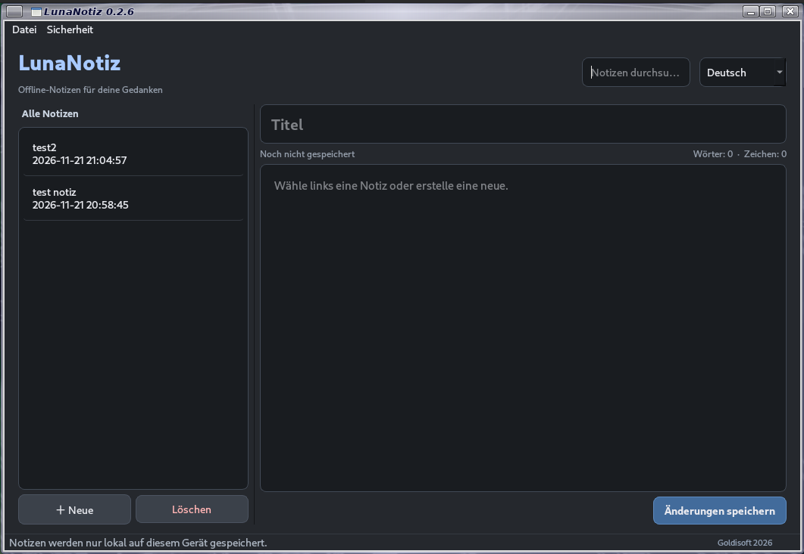

# LunaNotiz 0.2.6

LunaNotiz ist eine lokale Notizverwaltung für Linux mit SQLite und PySide6.



[Github Seite](https://github.com/Angonikro/LunaNotiz/)

## Funktionen
- Notizen erstellen, bearbeiten, durchsuchen und löschen
- Deutsche und englische Oberfläche
- Optionaler PIN-Schutz beim Programmstart (4–8 Ziffern)
- PIN ändern oder Schutz deaktivieren über **Sicherheit**
- Export aller Notizen als JSON
- Verschlüsselte Sicherungen mit AES-256-GCM und scrypt
- Import verschlüsselter und unverschlüsselter Sicherungen
- Importmodus: Zusammenführen oder vorhandene Notizen nach ausdrücklicher Bestätigung ersetzen
- Einheitlich deutsche Schaltflächen in Import-/Export-Dateidialogen und Bestätigungsfenstern

## Installation (Debian / Raspberry Pi OS)

```bash
sudo apt install ./lunanotiz_0.2.6_all.deb
```

Start über das Anwendungsmenü oder mit:

```bash
lunanotiz
```

## Start aus dem ZIP

Abhängigkeiten installieren:

```bash
sudo apt update
sudo apt install python3-pyside6.qtwidgets python3-pyside6.qtgui python3-cryptography
```

Im entpackten Ordner `LunaNotiz` starten:

```bash
python3 main.py
```

## Speicherort

Die Notizdatenbank liegt unter `~/.local/share/lunanotiz/notizen.sqlite3` (oder unter `$XDG_DATA_HOME/lunanotiz/`). Die PIN-Einstellungen liegen in den normalen Qt-Benutzereinstellungen.

## Sicherheitshinweise

Der PIN ist eine Zugangssperre für die Anwendung; die lokale SQLite-Datenbank selbst wird in dieser Version **nicht** verschlüsselt. Wer Zugriff auf das Benutzerkonto bzw. die Datenbankdatei hat, kann die Daten daher weiterhin außerhalb von LunaNotiz lesen. Für vertrauliche Inhalte bitte **Verschlüsselte Sicherung (AES-256-GCM)** verwenden und ein starkes, einzigartiges Backup-Passwort wählen.

Die PIN wird nicht im Klartext gespeichert. Wird sie vergessen, kann LunaNotiz sie nicht wiederherstellen. Verschlüsselte Backups lassen sich ohne ihr Backup-Passwort nicht öffnen. PIN und Backup-Passwort daher sicher aufbewahren.

## Lizenz

Siehe `LICENSE`.
