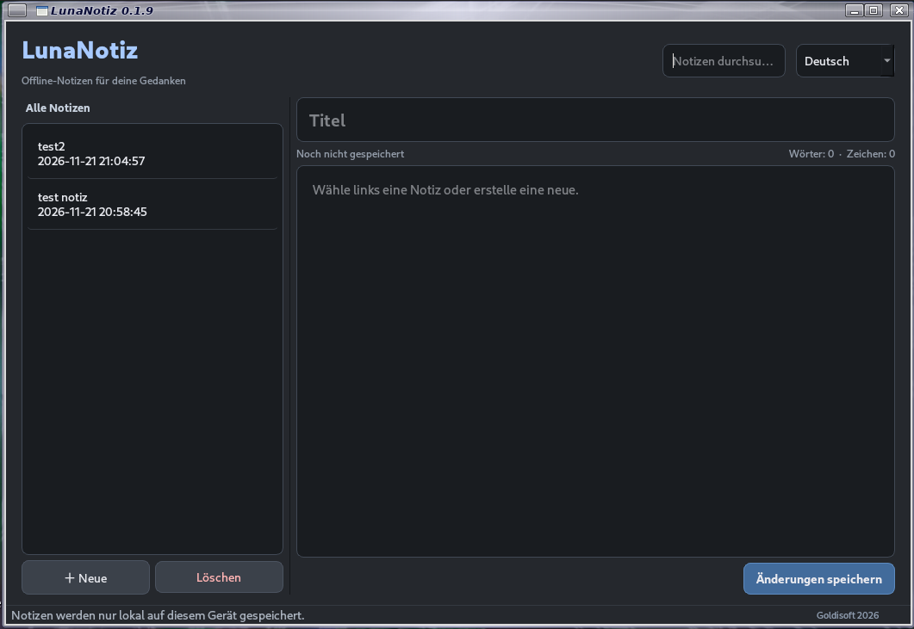

# LunaNotiz 0.1.9

**LunaNotiz** ist eine schlanke, lokale Notizenverwaltung für Debian und Raspberry Pi. Die Oberfläche ist auf **Deutsch und Englisch** verfügbar. Die Anwendung arbeitet vollständig offline und speichert alle Notizen in einer lokalen SQLite-Datenbank.



[Github Seite](https://github.com/Angonikro/LunaNotiz/)

## Funktionen

- Kontextmenüs in Titelfeld, Suchfeld und Notizeditor sind passend zur gewählten Sprache lokalisiert.
- Dezenter Herstellerhinweis „Goldisoft 2026“ in der Statusleiste.

- Notizen erstellen, bearbeiten, durchsuchen und löschen
- Zweisprachige Oberfläche (Deutsch/English) mit dauerhaft gespeicherter Sprachauswahl
- Editor mit Wort- und Zeichenzähler
- Anzeige des letzten Änderungszeitpunkts
- Schutz vor versehentlichem Verlust ungespeicherter Änderungen
- Rückfrage beim Wechsel zu einer anderen Notiz, beim Erstellen einer neuen Notiz und beim Beenden
- Tastenkürzel: `Strg+N` neue Notiz, `Strg+S` speichern, `Strg+F` Suche, `Entf` löschen
- Deutsches bzw. englisches Kontextmenü im Editor
- Modernisiertes Graphit-Design mit klarer Notizenliste und hervorgehobenem Editor
- Vollständig offline; keine Konten, Telemetrie oder Netzwerkverbindung

## Voraussetzungen

- Debian 13 (Trixie), empfohlen auf ARM64/aarch64
- Python 3.13
- PySide6 mit QtWidgets und QtGui

## Installation mit DEB

Im Terminal im Download-Ordner:

```bash
sudo apt install ./lunanotiz_0.1.9_all.deb
```

Danach LunaNotiz über das Anwendungsmenü unter **Dienstprogramme/Büro** oder im Terminal starten:

```bash
lunanotiz
```

Das Paket installiert den Starter, das Programmskript und das Anwendungssymbol. Die benötigten Python-Pakete werden über die Debian-Abhängigkeiten installiert.

## Start aus dem ZIP-Quellcode

ZIP entpacken und in das Projektverzeichnis wechseln. Die Projektstruktur enthält den Ordner `quellcode/`.

Fehlende Laufzeitabhängigkeiten installieren:

```bash
sudo apt install python3 python3-pyside6.qtwidgets python3-pyside6.qtgui
```

Anwendung starten:

```bash
cd quellcode
python3 main.py
```

## Sprache ändern

Oben rechts im Hauptfenster befindet sich die Sprachauswahl. **Deutsch** oder **English** auswählen. Die Auswahl wird lokal gespeichert und beim nächsten Start wiederhergestellt. Ein Sprachwechsel verändert keine Notizen und verwirft auch keinen gerade geschriebenen Entwurf.

## Bedienung

- Über **＋ Neue** oder `Strg+N` eine Notiz erstellen.
- Links eine Notiz auswählen; rechts Titel und Inhalt bearbeiten.
- Mit **Änderungen speichern** oder `Strg+S` speichern.
- Das Suchfeld oder `Strg+F` durchsucht Titel und Inhalt.
- `Entf` löscht die ausgewählte Notiz nach einer Sicherheitsabfrage.
- Der Editor zeigt Wort- und Zeichenzahl sowie den letzten gespeicherten Änderungszeitpunkt.

Wenn du eine Notiz mit ungespeicherten Änderungen wechselst, eine neue Notiz anlegst oder LunaNotiz beendest, fragt die Anwendung nach: Speichern, Verwerfen oder Abbrechen. So bleibt der aktuelle Text geschützt.

## Datenspeicherung und Sicherung

Notizen liegen standardmäßig hier:

```text
~/.local/share/lunanotiz/notizen.sqlite3
```

Wenn `XDG_DATA_HOME` gesetzt ist, wird dieses Verzeichnis verwendet. Die Datenbankstruktur bleibt gegenüber Version 0.1.7 kompatibel; bestehende Notizen werden beim Aktualisieren weiterverwendet.

Zum Sichern LunaNotiz schließen und die Datei `notizen.sqlite3` kopieren. Zum Wiederherstellen die Anwendung schließen und die gesicherte Datei an denselben Speicherort zurückkopieren.

## Paket selbst bauen

Im Projektstamm das Skript ausführen:

```bash
./quellcode/build_release.sh
```

Benötigt werden `dpkg-deb`, `python3` und `zip`. Das Skript prüft die Python-Syntax und erstellt ein architekturunabhängiges DEB sowie eine saubere Quellcode-ZIP im Ordner `release/`.

## Lizenz

MIT; siehe `LICENSE`.

73 de DO2QG Andreas